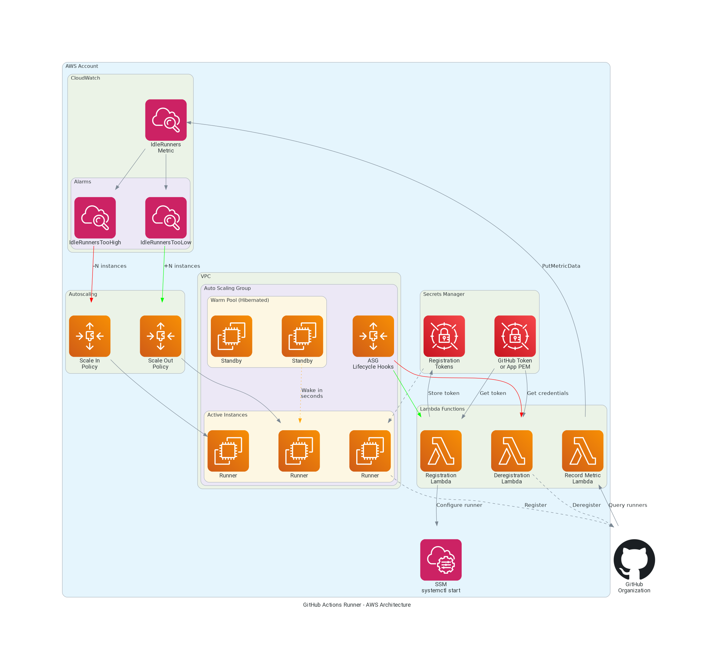

# Architecture

This document explains how the InfraHouse GitHub Actions Runner module works.

## Overview



## Components

### Auto Scaling Group

The core of the module is an AWS Auto Scaling Group that manages EC2 instances:

- **Launch Template**: Defines instance configuration (AMI, instance type, security groups)
- **Scaling Policies**: Step scaling based on CloudWatch alarms
- **Lifecycle Hooks**: Ensure proper registration/deregistration with GitHub
- **Warm Pool**: Keeps hibernated instances ready for fast scaling

### Lambda Functions

Three Lambda functions manage the runner lifecycle:

#### 1. Registration Lambda (`runner_registration`)

Triggered by ASG lifecycle hook when an instance launches:

1. Retrieves GitHub credentials from Secrets Manager
2. Generates a runner registration token
3. Stores token in Secrets Manager for the instance to retrieve
4. Completes the lifecycle hook

#### 2. Deregistration Lambda (`runner_deregistration`)

Triggered by ASG lifecycle hook when an instance terminates:

1. Sends SSM command to gracefully stop the runner service
2. Deregisters the runner from GitHub
3. Cleans up the registration token from Secrets Manager
4. Completes the lifecycle hook

Also runs on a schedule to clean up orphaned runners.

#### 3. Record Metric Lambda (`record_metric`)

Runs on a schedule (default: every minute):

1. Queries GitHub API for current runner status
2. Counts idle runners
3. Publishes metric to CloudWatch
4. CloudWatch alarms trigger scaling based on this metric

### CloudWatch Alarms

Two alarms control scaling:

- **idle_runners_low**: Triggers scale-out when idle runners < target
- **idle_runners_high**: Triggers scale-in when idle runners > target

### Warm Pool

The warm pool keeps instances in a hibernated state:

- Instances are fully booted and configured
- When needed, they wake up in seconds (vs. minutes for cold start)
- Disabled automatically when using spot instances (AWS limitation)

## Instance Lifecycle

### Launch Sequence

```
1. ASG decides to launch instance
         │
         ▼
2. Instance starts from launch template
         │
         ▼
3. registration lifecycle hook fires
         │
         ▼
4. Registration Lambda:
   - Gets GitHub token/App credentials
   - Creates runner registration token
   - Stores token in Secrets Manager
   - Completes hook
         │
         ▼
5. Instance cloud-init runs:
   - Installs packages
   - Runs Puppet (if configured)
   - Retrieves registration token
   - Registers runner with GitHub
   - Starts runner service
         │
         ▼
6. bootstrap lifecycle hook fires
         │
         ▼
7. Bootstrap wrapper signals the hook:
   - CONTINUE if every runcmd step (puppet, post_runcmd, ...) succeeded
   - ABANDON via ERR trap on the first failure — the ASG then terminates the
     instance instead of letting a broken runner join the fleet
         │
         ▼
8. Instance enters InService state
         │
         ▼
9. Runner picks up jobs from GitHub
```

### Termination Sequence

```
1. ASG decides to terminate instance
   (scale-in, max lifetime, health check)
         │
         ▼
2. deregistration lifecycle hook fires
         │
         ▼
3. Deregistration Lambda:
   - Sends SSM command: stop runner service
   - Waits for running job to complete
   - Deregisters runner from GitHub
   - Deletes registration token
   - Completes hook
         │
         ▼
4. Instance terminates
```

### Instance Refresh

A change to the launch template (a new AMI, new user data, a new instance role, a bigger root volume) gives it a new
version. `terraform apply` points the ASG at the new version and starts a rolling instance refresh
(`min_healthy_percentage = 100`), which replaces every runner through the launch and termination sequences above.
Terraform starts the refresh and returns; it doesn't wait for the refresh to finish.

A runner protects itself from scale-in for the length of every job: `gha_prerun.sh` turns the protection on when a
job starts, and `gha_postrun.sh` turns it off when the job ends. The refresh sets
`scale_in_protected_instances = "Wait"` for those runners:

- **`Wait`** (since 6.0.0): the refresh waits for the job to end and replaces the runner once the protection is lifted.
  This matters most when the change is applied by a CD job on the pool's own runner: that runner is protected when
  the refresh starts. While it waits, the refresh replaces runners that aren't protected but doesn't get to the warm
  pool. AWS waits up to one hour; if a runner is still protected after that, the refresh fails, and that runner and
  the warm pool stay on the old version until a refresh is started by hand (see
  [When the refresh fails](upgrading.md#when-the-refresh-fails)).
- **`Ignore`**, the AWS provider's default and what the module used up to 5.0.0, leaves protected runners out and
  replaces them only if their protection is lifted before the refresh ends. When the change is applied by a job on
  the pool's own runner and the refresh ends before the job, the refresh ends `Successful` with that runner still on
  the old version ([#112](https://github.com/infrahouse/terraform-aws-actions-runner/issues/112)).
- **`Refresh`** replaces protected runners right away, so it would terminate runners in the middle of long-running
  jobs.

## Scaling Behavior

### Scale Out (Add Runners)

1. `record_metric` Lambda publishes idle runner count
2. `idle_runners_low` alarm enters ALARM state
3. ASG scaling policy adds instances
4. If warm pool has instances: wake from hibernation (fast)
5. If warm pool empty: launch new instance (slower)

### Scale In (Remove Runners)

1. `record_metric` Lambda publishes idle runner count  
2. `idle_runners_high` alarm enters ALARM state
3. ASG scaling policy removes instances
4. Lifecycle hook ensures graceful deregistration
5. Instance returns to warm pool (if enabled) or terminates

## Security Model

### Instance Permissions

Runners have minimal IAM permissions:

- SSM for command execution
- Secrets Manager read for registration token only
- CloudWatch for metrics

### Lambda Permissions

Each Lambda has scoped permissions:

- Registration: Secrets Manager write, GitHub API
- Deregistration: SSM commands, Secrets Manager delete, GitHub API
- Record Metric: GitHub API read, CloudWatch put metric

### IAM Role Naming

The module's roles have distinct, predictable name prefixes, so a policy can select one kind by name pattern
(for example `ArnLike` on `aws:PrincipalArn`) without the other:

| Role | Name |
|------|------|
| Instance role | `actions-runner-instance-<pool>` |
| Registration Lambda | `actions-runner-lambda-<pool>-reg-<suffix>` |
| Deregistration Lambda | `actions-runner-lambda-<pool>-dereg-<suffix>` |
| Record-metric Lambda | `actions-runner-lambda-<pool>-metric-<suffix>` |

- `<pool>` is the random 6-character suffix of the ASG name, the same in all four names, so a pool's roles read as
  a set, for example `actions-runner-instance-lam2UA` and `actions-runner-lambda-lam2UA-reg-…`. It stays the same
  for the life of the pool, including when the launch template is replaced, and differs between pools, so two pools
  in one account never collide and the module needs no role name from the caller.
- `<suffix>` is the 26-character suffix Terraform appends to a `name_prefix`.
- `actions-runner-lambda-*` matches every pool's Lambda roles and no instance role; the
  `lambda_role_arn_pattern` output matches this pool's Lambda roles only. The instance role carries `<pool>` too,
  so don't select the Lambdas by `<pool>` alone.

The instance profile keeps its own name, `actions-runner-<random suffix>`. The instance role name is passed to the
instances as the `instance_role_name` Puppet fact, so when an upgrade replaces the instance role, the runners roll
too: a running instance can keep the credentials of a role swapped out of its instance profile for up to an hour.

### Network

- Runners in private subnets with NAT gateway
- Lambdas in VPC with access to AWS services
- Security group allows only outbound traffic
