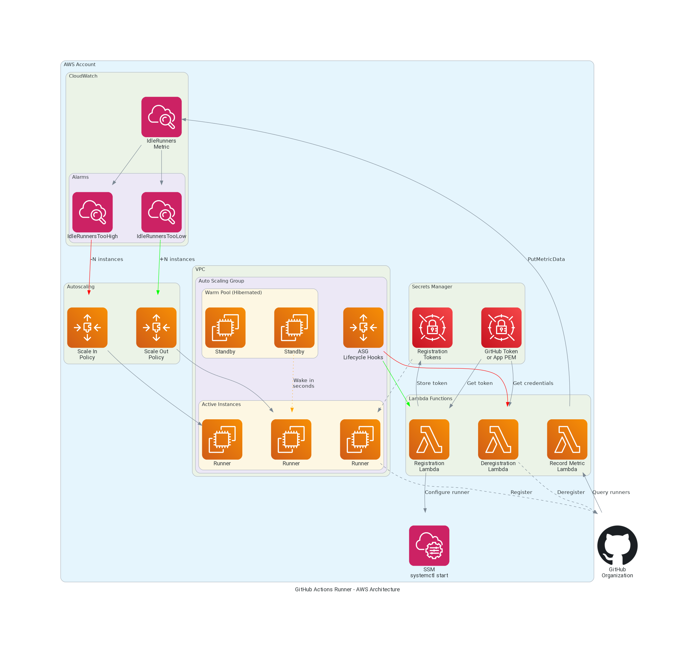

# InfraHouse GitHub Actions Runner

This Terraform module creates an Auto Scaling Group (ASG) and registers its instances
as self-hosted runners for GitHub Actions. It supports authentication using either a
classic GitHub token or temporary tokens obtained via a GitHub App.

!!! note
    The module registers organization-level runners only even though GitHub supports repository-specific runners.



## Why Self-Hosted Runners?

Self-hosted runners offer several advantages over GitHub-hosted runners:

- **Cost Efficiency:** Run workflows on your own infrastructure, potentially reducing costs for high-volume CI/CD
  pipelines, especially when using spot instances.
- **Custom Hardware:** Use specific CPU architectures, GPUs, or other specialized hardware required by your workloads.
- **Access to Private Resources:** Runners deployed in your VPC can access private databases, internal APIs, and other
  resources without exposing them to the internet.
- **Larger Compute Resources:** Go beyond GitHub-hosted runner limits with custom instance types that have more CPU,
  memory, or storage.
- **Compliance and Security:** Keep sensitive data and build artifacts within your own infrastructure to meet
  regulatory requirements.
- **Caching and Performance:** Leverage persistent storage and network proximity to your resources for faster build
  times.

## Why This Module?

There are several community modules for GitHub Actions runners on AWS. Here's why InfraHouse built its own:

### Design Philosophy

| Aspect | InfraHouse Module | Community Modules |
|--------|-------------------|-------------------|
| **Scaling** | ASG-native with CloudWatch metrics | Lambda-driven, bypasses ASG |
| **Warm Pool** | Native ASG warm pool (hibernated instances) | Not supported |
| **Configuration** | Puppet-based | Shell scripts |
| **Complexity** | ASG + CloudWatch + 3 Lambdas | API Gateway + Webhooks + SQS + EventBridge + 6+ Lambdas |
| **Compliance** | Built-in Lambda monitoring (ISO 27001) | Basic logging only |

### Key Advantages

- **Fast instance availability**: Warm pool keeps hibernated instances ready — they wake up in seconds
- **Puppet integration**: Works with your existing Puppet infrastructure
- **Simpler operations**: Fewer moving parts means easier debugging at 2am
- **Compliance-ready**: All Lambdas use `terraform-aws-lambda-monitored` with error alerting, throttle monitoring, and
  configurable log retention

## Features

- **Auto Scaling Group of runners** on the latest Ubuntu AMI for `ubuntu_codename` (Ubuntu Pro `noble` by default),
  or on your own `ami_id`. IMDSv2 is required, the root volume is encrypted, and instances are replaced after
  `max_instance_lifetime_days` (30 by default).
- **Hibernated warm pool**, on by default and sized with `warm_pool_min_size` and `warm_pool_max_size`.
- **Spot instances with an on-demand base**: set `on_demand_base_capacity`, and the capacity above it is spot. The
  warm pool is off in this mode.
- **Autoscaling on idle runners**: the `record_metric` Lambda publishes `BusyRunners` and `IdleRunners` every minute,
  and CloudWatch alarms add or remove `autoscaling_step` instances to keep `idle_runners_target_count` runners idle.
- **GitHub App or classic token authentication**: the App's private key in a KMS key it can't leave
  (`github_app_kms_key_arn`, the Lambdas sign with `kms:Sign`) or in Secrets Manager (`github_app_pem_secret_arn`),
  with `github_app_id`; or a classic token in Secrets Manager (`github_token_secret_arn`). As a GitHub App, each Lambda
  asks GitHub for an installation token with only the permissions it needs.
- **Registration Lambda** on the launch lifecycle hook: it creates a runner registration token and stores it in
  Secrets Manager for the new instance.
- **Deregistration Lambda** on the termination lifecycle hook, plus a sweep every 30 minutes that removes orphaned
  runners from GitHub.
- **Bootstrap lifecycle hook**: an instance whose cloud-init or Puppet run fails is abandoned and never enters
  service.
- **Scale-in protection while a job runs**, and instance refreshes that wait for protected runners.
- **Puppet configuration through cloud-init**: Hiera and module paths, plus `packages`, `extra_files`, `extra_repos`
  and `post_runcmd`.
- **Runner labels**: `extra_labels` on top of the labels the module adds (`aws_region:…`, `aws_account:…`,
  `installation_id:…`).
- **Alarms and a dashboard**: an SNS topic for `alarm_emails`, fanned out to `alarm_topic_arns`; alarms on CPU, the
  ASG at or saturated at its maximum, no instances in service, stuck launches, an empty warm pool and instances that
  never registered; error, throttle and memory alarms on every Lambda function (via terraform-aws-lambda-monitored);
  and a CloudWatch dashboard for the pool.
- **Predictable IAM role names**: `actions-runner-instance-<pool>` and `actions-runner-lambda-<pool>-…`, with
  outputs for writing policies against them.
- **AWS provider 5 and 6** (`>= 5.31, < 7.0`).

## Quick Start

The module needs a Secrets Manager secret that holds either a classic GitHub token with the `admin:org` scope or the
private key of a GitHub App (see [Authentication](authentication.md)). With a token:

```hcl
module "actions_runner" {
  source  = "registry.infrahouse.com/infrahouse/actions-runner/aws"
  version = "6.0.0"

  environment             = "production"
  github_org_name         = "your-org"
  subnet_ids              = ["subnet-0123456789abcdef0", "subnet-0fedcba9876543210"]
  alarm_emails            = ["oncall@example.com"]
  github_token_secret_arn = "arn:aws:secretsmanager:us-west-2:123456789012:secret:GITHUB_TOKEN-AbCdEf"
}
```

Set exactly one GitHub credential. To authenticate as a GitHub App, set `github_app_id` and either
`github_app_kms_key_arn`, a KMS key that holds the App's private key (recommended), or `github_app_pem_secret_arn`, a
secret that holds it. See [Authentication](authentication.md).

Puppet configures the runners, and its `profile::github_runner` reads the organization from Hiera
(`profile::github_runner::url` and `profile::github_runner::org`). Provide them in your Hiera data, for instance in a
package listed in `packages`, and point `puppet_hiera_config_path` at its `hiera.yaml`, as the
[examples](https://github.com/infrahouse/terraform-aws-actions-runner/tree/main/examples) in the repository do. They
are complete root modules for both kinds of authentication.

## Documentation

- [Getting Started](getting-started.md) — Prerequisites and first deployment
- [Architecture](architecture.md) — How the module works
- [Configuration](configuration.md) — All available options
- [Authentication](authentication.md) — GitHub App vs Token setup
- [Scaling](scaling.md) — Warm pool, autoscaling, and spot instances
- [Monitoring](monitoring.md) — Lambda alerting and compliance
- [Examples](examples.md) — Common deployment patterns
- [Troubleshooting](troubleshooting.md) — Common issues and solutions
- [Upgrading](upgrading.md) — What to change when you upgrade, and notes on earlier releases
- [Comparison](comparison.md) — How this module compares to alternatives
- [Changelog](changelog.md) — Every change, release by release
